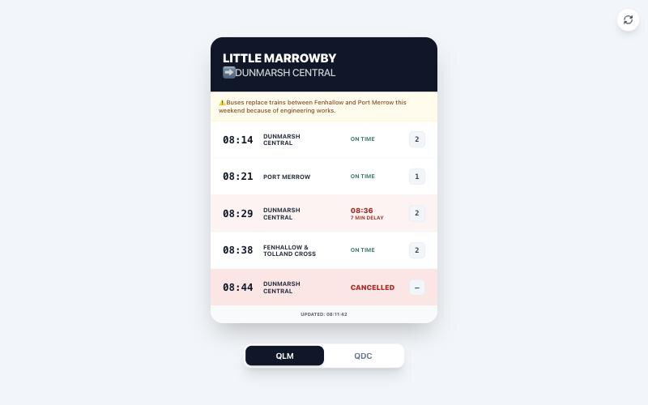

# Trains

A small, self-hosted departure board for the journey you make most, such as your commute to and from work or the regular trip to see family. Choose two stations, and it shows the next trains between them, with one tap to switch direction.

Instead of searching a full journey planner on the platform, you can add it to your phone's home screen and see straight away whether your train is on time, late or cancelled.

It's plain PHP and CSS, with no build step, no Composer dependencies and no database.



The stations and trains in this screenshot are made up.


## Features

- **There and back:** one board for each direction, with a toggle that remembers the last one you viewed. Ideal for a morning and evening commute.
- **Only your trains:** each board lists up to 10 departures that call at your other station.
- **Clear status:** on-time, delayed and cancelled trains are colour-coded, with the delay shown in minutes and the platform when it's known.
- **Disruption notices:** shows National Rail's service messages at the top of the board.
- **Split trains:** names every destination when a train divides along the way.
- **Stays up to date:** refreshes every 60 seconds, and has a button to refresh sooner.
- **Add to your home screen:** includes a web app manifest and icons, so it opens like an app on your phone.
- **Light on the API:** fetches both boards in parallel, and reuses each successful response for 30 seconds.

## Requirements

- PHP 8 or newer with `curl` and `SimpleXML`
- A web server that runs PHP
- A National Rail token (see [Get a National Rail token](#get-a-national-rail-token))

## Project layout

```text
.
├── nre-config.sample.php      Template for your token
├── nre-config.php             Your real token (git-ignored, create this yourself)
├── LICENSE                    MIT License
├── docs/screenshot.jpg        Demo screenshot used in this README
├── template/
│   ├── index.php              The page, with gaps for your station codes
│   └── site.webmanifest       Home screen settings
└── public_html/
    ├── index.php              Your copy of the page (git-ignored, create this yourself)
    ├── site.webmanifest       Your copy of the manifest (git-ignored, create this yourself)
    ├── style.css              Styles
    ├── lib/nre.php            Fetches, caches and parses the departure data
    └── favicon and app icons
```

## Get a National Rail token

The boards use live data from National Rail, which needs an access token. **Check this first, because the sign-up route has changed.**

This app calls National Rail's older [OpenLDBWS SOAP service](https://lite.realtime.nationalrail.co.uk/OpenLDBWS/documentation.aspx), which expects your token in a SOAP header:

- **If you already have an OpenLDBWS token:** use it as it is.
- **If you don't have one:** the old OpenLDBWS sign-up page no longer exists (it returned a 404 in November 2026). National Rail now [sends developers to the Rail Data Marketplace](https://www.nationalrail.co.uk/developers/darwin-data-feeds).

To get a key from the Rail Data Marketplace:

1. [Register with the Rail Data Marketplace](https://raildata.org.uk/registerPartner).
2. Find the **Live Departure Board** product and subscribe to it.
3. Open the product's **Specification** tab and copy the **Consumer key** from its API access credentials.

The Marketplace product is a JSON API, not the SOAP service this app calls, so a Marketplace key may not work without changes. If it doesn't, you'd need to update `nre_fetch_boards()` and `nre_parse()` in `public_html/lib/nre.php` to use the new API.

Using the data means accepting National Rail's [terms and conditions](https://assets.nationalrail.co.uk/e8xgegruud3g/3CwdjHiP1dGYdq5a5j2dQP/007f67f4c2192df230f52f8cf55e55d1/Terms_and_Conditions.pdf). Its [developers page](https://www.nationalrail.co.uk/developers/) also covers how to credit National Rail as the data source.

## Setup

### 1. Add your token

```bash
cp nre-config.sample.php nre-config.php
```

Put your token in `nre-config.php`, and keep this file **outside your web root**. On the server, it goes in the folder above `public_html`. You can set an `NRE_TOKEN` environment variable instead.

### 2. Add your stations

```bash
cp template/index.php public_html/index.php
```

```bash
cp template/site.webmanifest public_html/site.webmanifest
```

Fill in the two gaps at the top of `public_html/index.php` using three-letter CRS station codes. For example, `PAD` is London Paddington:

```php
const STATION_A = ''; // e.g. the station nearest home
const STATION_B = ''; // e.g. the station nearest work
```

To give the home screen icon your own label, change `name` and `short_name` in `public_html/site.webmanifest`, and `apple-mobile-web-app-title` in `public_html/index.php`.

Until both codes are filled in, the page only shows a reminder to add them.

### 3. Upload it

Upload the contents of `public_html/` to a folder called `trains` in your web root, so the page is at `https://your-site.example/trains/`. Then open that address.

The page and manifest use `/trains/` for their links. If you choose another folder name, update those paths in `index.php` and `site.webmanifest`.

## Security

- **Don't commit your token or stations.** `.gitignore` excludes `nre-config.php`, `public_html/index.php`, `public_html/site.webmanifest`, logs and deployment settings.
- **There's no login.** Anyone with the address can see your board, including the stations you chose. Put it behind HTTP authentication if you'd rather keep your commute private.
- **Page protection:** the page sends a strict Content Security Policy, and removes everything except plain text and http(s) links from National Rail's messages.
- **Private includes:** `lib/.htaccess` stops `lib/` from being opened directly on Apache. On other web servers, add your own rule.

## License

Trains is released under the [MIT License](LICENSE), © 2026 Mark Duwe. You can use, change and share it freely, including commercially, as long as you keep the copyright and licence notice in all copies or substantial portions of the code.

This project isn't affiliated with or endorsed by National Rail.
